# An Empirical Study of Coordination Strategies for Multi-Agent Pathfinding (MAPF)

*Undergraduate AI course project — implementation, controlled experiments, and
interactive demonstration.*

**Research question.** *How does the choice of coordination strategy affect the
efficiency, solution quality and scalability of multi-agent pathfinding under
different environment conditions?*

**Optional extension.** *Can the characteristics of a MAPF instance be used to
select an appropriate coordination strategy automatically?*

---

## Abstract

We implement classical multi-agent pathfinding on 4-connected grids and compare
three coordination strategies of increasing sophistication — **Independent A***
(no coordination), **Prioritized Planning** (decoupled, sequential) and
**Conflict-Based Search** (optimal, two-level) — under a controlled experimental
design that varies the number of agents, obstacle density, map structure,
start/goal distribution and map size, with several random seeds per condition.
All three planners share the same low-level A*, the same conflict definitions and
the same validation code, and every instance is solved by every algorithm, so
comparisons are paired by construction.

The experiments show a clear and consistent picture. Independent A* is
essentially free but almost immediately useless: the number of collisions it
produces grows super-linearly in the number of agents, and from about 15 agents
onwards on a 32×32 map it never produces a usable plan. Prioritized Planning
remains fast (milliseconds) and solves the great majority of instances, but its
incompleteness is real and structure-dependent, and its plans drift away from
optimal as congestion grows. CBS delivers optimal plans but its runtime is
heavily tailed: it is comfortably usable up to roughly 20 agents and then
increasingly hits the time budget. Crucially, *no single strategy dominates*:
which one is preferable depends on measurable properties of the instance — the
number of agents, how much congestion the start/goal placement creates, and how
constrained the topology is. That observation is what motivates the (optional)
adaptive selector evaluated in Section 8.

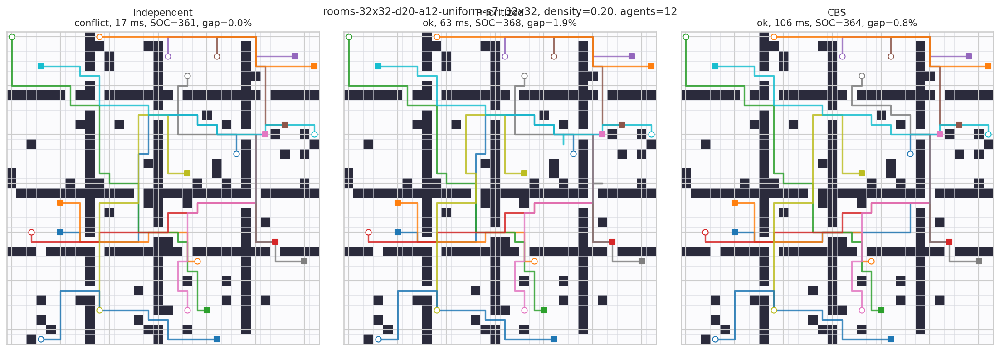
*The same 32×32 room map with 12 agents. Left: Independent A* (colliding — the
red stars in the next figure mark them). Middle: Prioritized Planning. Right:
CBS. The three plans differ only in how much coordination they paid for.*

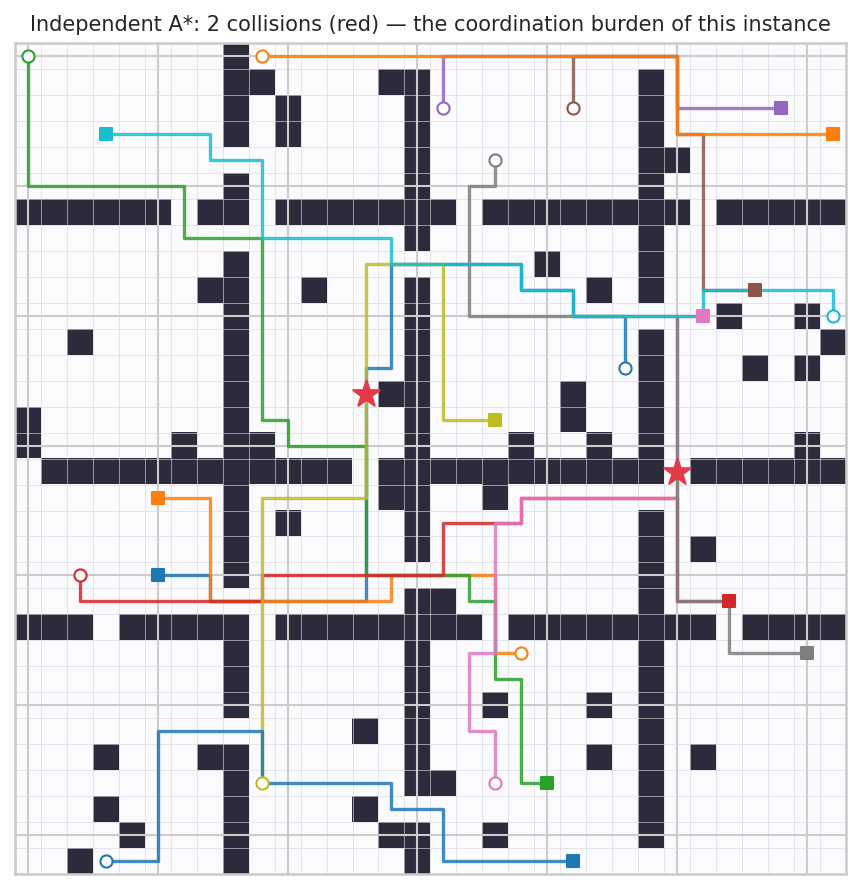
*Independent A* on that instance: every red star is a cell where two agents
collide. This is the "coordination burden" the other two strategies have to
absorb.*

**Contributions of this project.** (1) A tested, modular implementation of the
three strategies plus conflict detection and plan validation (113 unit tests,
including an exhaustive optimality cross-check of CBS against brute-force
joint-state search). (2) A reproducible experiment pipeline with raw results,
configuration files and figures. (3) A quantitative comparison across five
environmental factors. (4) An interactive browser demo that *explains* the
findings rather than merely displaying them. (5) A small, clearly-labelled
extension that selects a strategy from cheap instance features.

---

## 1. Introduction

Coordinating a fleet of agents that must move through a shared environment
without colliding is the *Multi-Agent Pathfinding* (MAPF) problem. It is the
abstraction behind warehouse robotics, aircraft taxiing, video-game crowds and
traffic management. The combinatorial difficulty is not in routing a single
agent — that is a shortest-path problem — but in the *interaction* between
agents: a plan that is optimal for each agent individually is usually not
feasible for the fleet.

The naive approach (plan every agent independently) is fast and wrong. The
optimal approach (search the joint state space) is correct and intractable
beyond a handful of agents. Between the two lies a spectrum of *coordination
strategies*, and the practical question for an engineer — and the question this
project asks — is: **which strategy, for which kind of instance, and at what
cost?**

Rather than implement many algorithms shallowly, this project implements three
well-understood points on that spectrum, validates them carefully, and then
measures them under controlled conditions.

## 2. Problem definition, assumptions and objectives

Following Stern et al. (2019), a *classical MAPF* instance is a tuple
⟨G, s, g⟩ where G = (V, E) is an undirected graph (here: a 4-connected grid),
s : {1…k} → V assigns a start vertex to each of k agents and g : {1…k} → V a
goal vertex. Time is discrete. At every timestep each agent performs one action
from {wait, up, down, left, right}, each of cost 1; at t = 0 agent i is at s(i).

**Conflicts (collisions).** A joint plan is *valid* iff it contains neither

* a **vertex conflict**: agents i ≠ j occupy the same vertex at the same
  timestep t;
* an **edge conflict**: agents i and j exchange vertices between t−1 and t.

A *follow conflict* (i enters a vertex that j left at the previous timestep) is
**not** a conflict under the classical pebble-motion model, and we follow that
convention; allowing it is a modelling decision and is what makes corridor
"trains" of agents possible.

**Stay at target.** Once an agent reaches its goal it remains there. This is
standard, and it has a concrete implementation consequence: in Prioritized
Planning an earlier agent's goal cell must be treated as *permanently* reserved,
which is exactly the mechanism behind some of that algorithm's failures.

**Objectives.** Let cost(pᵢ) = |pᵢ| − 1 be the number of actions agent i
performs until it first occupies its goal (waiting before arrival costs 1,
waiting afterwards costs nothing). Then

| Metric | Definition | Role |
|---|---|---|
| **SOC** (sum of costs) | Σᵢ cost(pᵢ) | primary objective; the one CBS optimises |
| **Makespan** | maxᵢ cost(pᵢ) | secondary; "when is the fleet done" |
| **SIC** (sum of individual costs) | Σᵢ cost(shortest path of i) | admissible lower bound on optimal SOC |
| **SOC excess over SIC** | SOC / SIC − 1 | scale-free solution quality; 0 ⇒ provably optimal |
| **Conflicts** | number of vertex/edge conflicts in a joint plan | measures how much coordination an instance needs |

SIC is the yardstick for quality: a strategy whose SOC equals SIC produces a
plan that is simultaneously optimal for every agent, which is the best any
fleet could hope for.

These assumptions are restated in `docs/assumptions.md`; changing any of them
(e.g. forbidding follow conflicts) would change the results, which is why they
are pinned down before any experiment is run.

## 3. Related work

**Reproduced in this project.**

* **A\*** with an admissible heuristic is the low-level planner for everything
  that follows (Hart, Nilsson & Raphael, 1968). We use the *true distance*
  (a backward BFS on the static grid) rather than Manhattan: it is still
  admissible and consistent, but strictly stronger on maps with obstacles.
* **Prioritized Planning** — plan agents one at a time against a space-time
  reservation table of the already-planned agents. This is the decoupled
  approach studied by Erdmann & Lozano-Pérez (1987) and popularised for MAPF by
  Silver's WHCA\* / cooperative A\* (2005). It is fast but incomplete for a fixed
  priority order and not optimal.
* **Conflict-Based Search (CBS)** — Sharon et al. (2015): a high-level
  best-first search over a constraint tree, where each node holds one constraint
  set and one path per agent, and a conflict is resolved by branching on which
  of the two agents is constrained. CBS is complete and SOC-optimal.

**Context (not re-implemented, but needed to interpret the results).**

* Kornhauser, Miller & Spirakis (1984) establish the pebble-motion foundation
  behind the follow-conflict assumption.
* Standley (2010) introduces operator decomposition and independence detection,
  the direct precursor of CBS; Wagner & Choset (2011) trade optimality for
  tractability (MAPP), a useful contrast for the "is optimality worth it?"
  discussion.
* Stern et al. (2019) fix the terminology, the variants and the benchmarking
  conventions used here.
* The CBS literature since 2015 (ICBS, CBSH, EECBS, SIPP-based MAPF, MAPF-LNS)
  is a large family of *improvements on top of* CBS. This project reproduces
  **plain CBS** so that the comparison with the baselines reflects the
  algorithms' own properties rather than engineering tricks. Any speed-up
  reported for those improvements would move the CBS curves in our plots to the
  right, not change their shape.

## 4. Algorithms

All three strategies share the same low-level solver and the same conflict
detector; they differ only in *how* agents are made to avoid each other. Each
returns the same result object with an explicit status (`ok`, `conflict`,
`no_solution`, `timeout`, `invalid`), so failures are recorded rather than
hidden.

### 4.1 Single-agent A\* (the low level)

Standard A\* over cells with a consistent heuristic h(cell) = exact static-grid
distance to the goal (backward BFS). Because h is consistent, A\* expands every
state at most once and returns an optimal path. The same heuristic is reused
inside the constrained search (it ignores other agents, which is what keeps it
admissible there).

For the coordinated planners we use a **time-expanded** variant over states
(cell, t) with unit action costs; legality of a space-time move is decided by a
pluggable *verifier*:

* `ConstraintVerifier` (CBS): the agent's own vertex/edge constraints.
  `can_terminate` encodes "stay at target": arriving at the goal at time t means
  occupying it at every t′ > t, so an early arrival that would violate a later
  constraint on the goal cell is rejected.
* `ReservationVerifier` (Prioritized Planning): the space-time reservation
  table of the higher-priority agents.

### 4.2 Independent A\*

Plan every agent with plain A\*, ignore everyone else, then count the conflicts.
It is included as a *deliberately naive baseline* and serves two purposes: (i) it
measures how much coordination an instance actually demands, and (ii) its SOC is
the SIC lower bound used to judge every other plan.

### 4.3 Prioritized Planning

```
order ← priority ordering of the agents          (index / random / cost / conflicts …)
table ← empty reservation table
for i in order:
    p ← time-expanded A*(start_i, goal_i) avoiding `table`
    if p is None: return FAILURE                 # incomplete!
    table ← table ∪ reservations(p)              # incl. permanent reservation of goal_i
return SUCCESS
```

Reservations record, for every timestep, the cells occupied and the edges
traversed by higher-priority agents; the goal cell of a higher-priority agent is
reserved for *all* later times. The priority ordering is exposed as a parameter
and is studied as an additional factor (Section 7.6).

Properties: polynomial (one A\* per agent), **not optimal**, and **incomplete**
for a fixed order — an agent blocked by the permanent goal reservation of a
higher-priority agent fails even when a different schedule would work. Our
experiments quantify exactly how often that happens.

### 4.4 Conflict-Based Search (CBS)

```
open ← {root node: one shortest path per agent, no constraints}
while open ≠ ∅:
    N ← node with minimum SOC (ties: fewer conflicts, then insertion order)
    if N's joint plan is conflict-free: return it          # optimal
    c ← first conflict ⟨aᵢ, aⱼ, v, t⟩ in N's plan
    for a in {aᵢ, aⱼ}:
        N′ ← N with the constraint (a may not use v at t; edge constraint if swap)
        if the constraint is already present: skip          # avoid duplicate nodes
        p ← time-expanded A*(start_a, goal_a) under N′'s constraints for a
        if p exists: N′.path[a] ← p; open ← open ∪ {N′}    # only a is replanned
```

We implement this exactly as described by Sharon et al. (2015), with two
documented engineering decisions that cannot change the returned cost: (i) the
conflict chosen for branching is the earliest one (deterministic), and (ii)
among equal-SOC nodes we expand the one with fewer remaining conflicts first
(a tie-break only).

## 5. Experimental setup

**Implementation.** Pure Python 3.13; planners and demo server use only the
standard library; `numpy/pandas/matplotlib/seaborn/scipy` are used for analysis
and figures only.

**Instances.** Procedurally generated (`environment/generators.py`), fully
determined by `(width, height, structure, density, distribution, agents, seed)`.
Four structures are used: `random` (uniform obstacles), `clusters` (cave-like
blobs), `rooms` (rooms joined by single-cell doorways — strong bottlenecks) and
`maze` (braided randomised-DFS maze). Four start/goal distributions vary
congestion: `uniform`, `clustered` (shared regions), `near` (goal close to its
own start) and `far` (goals deliberately far — long, crossing paths).

> **Methodological note (recorded because it changed the results).** An earlier
> version of the generator produced a map at an inflated obstacle density,
> pruned it to its largest connected component and then re-opened cells to
> restore the requested density. Near the site-percolation threshold of the
> square lattice (~41 % obstacles) that procedure produced comb-like, highly
> structured maps instead of uniform ones, which confounded the *obstacle
> density* factor (30 % and 40 % looked pathologically hard). The generator now
> samples exactly `density × area` obstacle cells uniformly and keeps small
> unreachable pockets, as the standard benchmark maps do; agents are placed
> inside the giant component. All results reported here come from the corrected
> generator (the superseded run is archived in `results/raw_superseded_v1/`).

**Suites** (`config/suites.json`, checked into git). Six controlled suites plus
the hold-out pool for the extension:

| Suite | Varied factor | Fixed conditions | Instances |
|---|---|---|---|
| `scalability` | agents ∈ {5,10,15,20,25,30,40} | 32×32, random, 20 %, uniform | 84 |
| `density` | obstacles ∈ {0,10,20,30,40 %} | 32×32, random, 10 & 20 agents | 80 |
| `structure` | random / clusters / rooms / maze | 32×32, 20 %, 10 & 20 agents | 64 |
| `distribution` | uniform / clustered / near / far | 32×32, 20 %, 20 agents | 40 |
| `gridsize` | 16², 32², 48², 64² | 20 % obstacles, 10 & 20 agents | 64 |
| `priority_orders` | 6 ordering rules + restarts | 32×32, 20 %, 10/20/30 agents | 24 |
| `adaptive_holdout` | mixed conditions | used only for Section 8 | 108 |

**Protocol.** Every algorithm runs on every instance (paired design). Per-run
wall-clock budget: **10 s**; exceeding it is recorded as `timeout`, never as a
success. Every returned plan is re-validated by independent code
(`evaluation/metrics.py`) that checks start/goal conformance, move legality,
obstacle avoidance and absence of vertex/edge conflicts; a plan that fails
validation is marked `invalid` and counted as a failure.

**Validation before measurement** (Section 10 of the brief): 113 unit tests
cover the grid, A\* (optimality checked against BFS on random maps), vertex and
edge conflict detection with hand-designed examples (including the *absence* of
follow conflicts), Prioritized Planning on small scenarios including a
hand-designed instance where it must fail, and CBS on hand-designed cases —
including an exhaustive brute-force joint-state Dijkstra that independently
confirms CBS's SOC is optimal on random 4×4/5×5 instances.

**Reproducibility.** `python scripts/run_experiments.py --workers 2` regenerates
everything; `results/raw/*.jsonl` stores one row per run; `results/raw/manifest.json`
records the suite configuration and the platform; `scripts/make_plots.py` and
`scripts/analyze.py` regenerate every figure and table from the raw rows.

---

## 6. Results

All numbers below are produced by `scripts/analyze.py` from
`results/raw/*.jsonl`; the corresponding tables are in `results/tables/` and the
figures in `results/figures/`. "SOC gap" always means *SOC excess over SIC*
(Section 2), i.e. how far a plan is from the unattainable ideal in which every
agent gets its own shortest path.

### 6.1 Overall behaviour

| Strategy | runs | success | timeout | hard failure | mean time | median time | SOC gap (solved) | worst gap | CBS high-level expansions |
|---|---|---|---|---|---|---|---|---|---|
| Independent A* | 332 | **9.0 %** | 0 % | 0 % (91 % returned colliding plans) | 0.028 s | 0.027 s | 0.00 %¹ | 0.00 %¹ | – |
| Prioritized Planning | 476 | **94.5 %** | 4.8 % | 0.6 % | 0.131 s | 0.038 s | 4.21 % | 72.8 % | – |
| CBS | 332 | **65.4 %** | 34.6 % | 0.0 % | 3.86 s | 0.215 s | **0.53 %** | 11.0 % | 544 |

¹ Independent A*'s SOC *is* SIC by construction — its plans are individually
optimal, they just collide. This is the baseline's whole point: cost is not the
problem, feasibility is.

Three facts jump out and drive everything that follows: (i) the naive baseline
is essentially never usable; (ii) Prioritized Planning is ~6× faster than CBS
in the median and fails rarely; (iii) CBS's mean runtime (3.86 s) is more than
ten times its median (0.215 s) — its cost distribution is extremely heavy-tailed.

### 6.2 How does the number of agents affect planning difficulty?

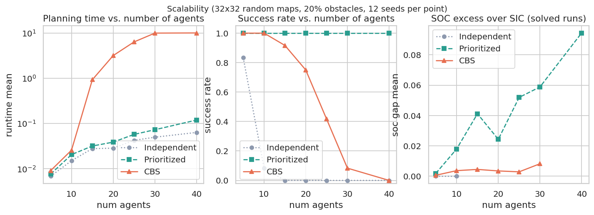

32×32, 20 % obstacles, uniform start/goal placement, 12 seeds per point.

| agents | conflicts in independent plan | Independent | Prioritized | CBS | CBS SOC gap | PP SOC gap |
|---|---|---|---|---|---|---|
| 5 | 0.3 | 83 % | 100 % / 0.008 s | 100 % / 0.009 s | 0.06 % | 0.19 % |
| 10 | 5.5 | 8 % | 100 % / 0.021 s | 100 % / 0.026 s | 0.37 % | 1.79 % |
| 15 | 7.3 | 0 % | 100 % / 0.032 s | 92 % / 0.93 s | 0.45 % | 4.12 % |
| 20 | 13.3 | 0 % | 100 % / 0.039 s | 75 % / 3.17 s | 0.35 % | 2.43 % |
| 25 | 19.5 | 0 % | 100 % / 0.057 s | 42 % / 6.34 s | 0.29 % | 5.20 % |
| 30 | 26.8 | 0 % | 100 % / 0.073 s | 8 % / 9.94 s | 0.82 % | 5.89 % |
| 40 | 55.9 | 0 % | 100 % / 0.119 s | 0 % / timeout | – | 9.45 % |

The coordination burden grows **super-linearly** with the fleet: quadrupling the
agents from 5 to 20 multiplies the conflicts in the naive plan by ~40 (0.3 →
13.3) and again by ~4 by 40 agents (55.9). Prioritized Planning's runtime grows
almost linearly (0.008 s → 0.119 s over an 8× increase in agents). CBS's runtime
grows *exponentially* in the same range (0.009 s → timeout), and its success
rate collapses between 15 and 30 agents. This is the central quantitative
trade-off of the study: at 40 agents Prioritized Planning is ~85× faster and
succeeds 100 % of the time, while CBS solves nothing within 10 s.

### 6.3 How does obstacle density affect each algorithm?

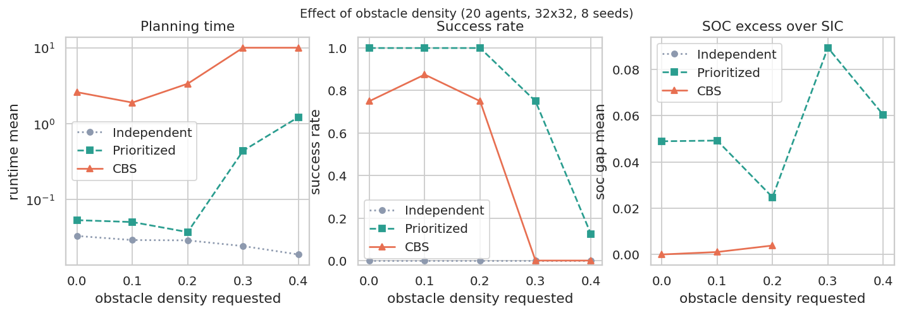

| density | conflicts (10 agents) | CBS (10) | PP (10) | conflicts (20 agents) | CBS (20) | PP (20) |
|---|---|---|---|---|---|---|
| 0 % | 3.3 | 100 % / 0.23 s | 100 % | 7.8 | 75 % / 2.60 s | 100 % |
| 10 % | 1.6 | 100 % / 0.02 s | 100 % | 8.8 | 88 % / 1.89 s | 100 % |
| 20 % | 6.9 | 100 % / 0.02 s | 100 % | 12.4 | 75 % / 3.36 s | 100 % |
| 30 % | 5.1 | 100 % / 1.17 s | 100 % | 23.6 | 0 % / timeout | 75 % |
| 40 % | 10.0 | 50 % / 5.22 s | 63 % | 56.9 | 0 % / timeout | 13 % |

Open maps are *not* the easy case for CBS: with 20 agents, the 0 %-obstacle map
(75 %) is no easier than the 20 % map (75 %), because with fewer obstacles the
agents' shortest paths funnel through the same open space. What matters is the
combination of density and fleet size: once the free space becomes scarce
relative to the number of agents (30–40 % obstacles with 20 agents), conflicts
explode (24 → 57) and *both* coordinated planners collapse — Prioritized
Planning from 100 % to 13 % success. Congestion, not obstacle count per se, is
the difficulty driver.

### 6.4 Which environments create the most conflicts? (map structure)

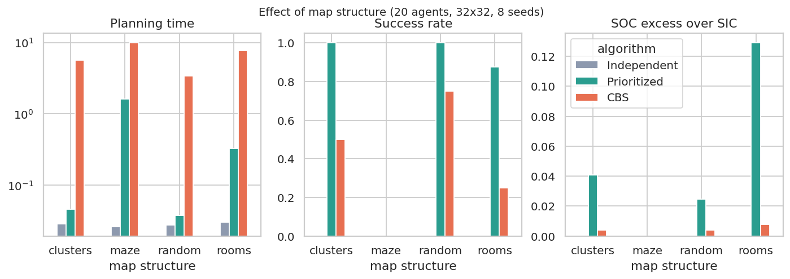

| structure | conflicts | CBS success | PP success | CBS time | PP time | CBS gap | PP gap |
|---|---|---|---|---|---|---|---|
| random | 9.6 | 88 % | 100 % | 1.71 s | 0.028 s | 0.37 % | 1.99 % |
| clusters | 7.7 | 75 % | 100 % | 2.83 s | 0.034 s | 0.51 % | 4.48 % |
| rooms | 20.1 | 56 % | 94 % | 5.35 s | 0.176 s | 1.07 % | 8.69 % |
| maze | 40.3 | **0 %** | **25 %** | timeout | 1.24 s | – | 35.0 % |

**Interpretation caveat.** The structure suite does not hold measured obstacle
density constant. Its nominal 20% parameter means a braid fraction for mazes,
while rooms retain the walls and doorways needed to define their topology; the
resulting measured densities differ across structures. These results therefore
compare the complete generated map families, not topology isolated from obstacle
density. The raw rows record measured density for follow-up stratification.

Structure matters at least as much as the number of agents. Room maps, with
their single-cell doorways, are the "interesting middle": they are solvable, but
every doorway is a negotiation, so CBS needs 3× longer than on random maps and
Prioritized Planning starts to fail (94 %). Perfect mazes are pathological:
corridors are one cell wide, so agents cannot pass each other at all, the naive
plan has ~40 conflicts, and even Prioritized Planning succeeds on only a
quarter of instances within the budget.

### 6.5 Start/goal distribution = congestion

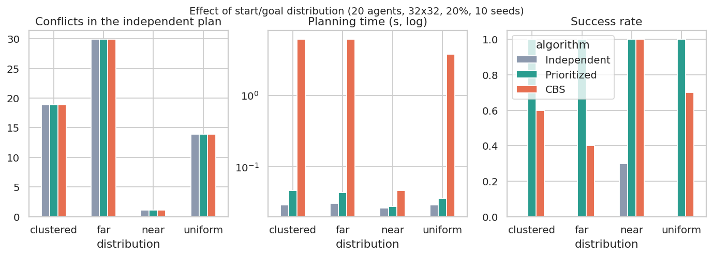

| distribution | conflicts | mean \|start−goal\| | CBS success | PP success | CBS time | PP time |
|---|---|---|---|---|---|---|
| near | **1.1** | short | **100 %** | 100 % | 0.047 s | 0.028 s |
| uniform | 13.9 | medium | 70 % | 100 % | 3.75 s | 0.036 s |
| clustered | 18.9 | medium | 60 % | 100 % | 6.11 s | 0.047 s |
| far | **29.9** | long | **40 %** | 100 % | 6.09 s | 0.044 s |

Holding everything else fixed, *where the goals are* changes CBS's success rate
from 100 % to 40 % — a larger effect than doubling the fleet from 20 to 25
agents. The number of conflicts in the naive plan (1.1 → 29.9) is a good
predictor of this: correlation with runtime over all runs is r = 0.29 overall
and the ordering of the four distributions is exactly the ordering of CBS
difficulty.

### 6.6 Map size

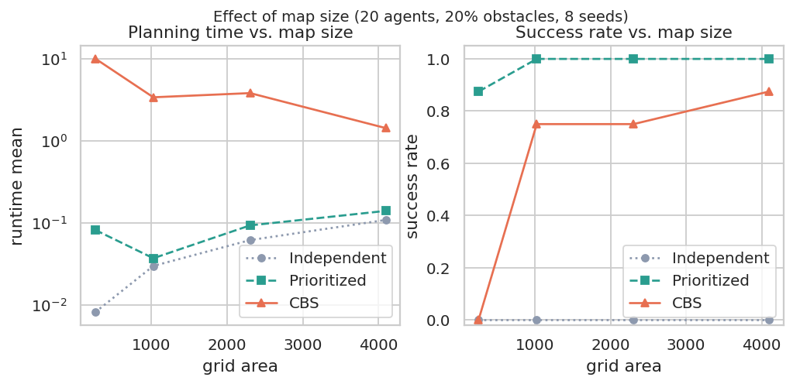

| map | CBS success | PP success | CBS time | PP time |
|---|---|---|---|---|
| 16×16 | 44 % | 94 % | 5.75 s | 0.044 s |
| 32×32 | 88 % | 100 % | 1.70 s | 0.027 s |
| 48×48 | 88 % | 100 % | 1.92 s | 0.065 s |
| 64×64 | 94 % | 100 % | 0.75 s | 0.108 s |

Counter-intuitively, **bigger maps are easier** at a fixed number of agents and
fixed obstacle density. What the planner feels is not the map size but the
*agent density* (agents per free cell): on the 16×16 map, 20 agents share ~205
free cells, whereas on 64×64 they share ~3 277. The 16×16 configuration is
therefore the most congested in the whole study — even more so than 40 agents on
a 32×32 map — and it is where CBS does worst.

### 6.7 Prioritized Planning: does the priority order matter?

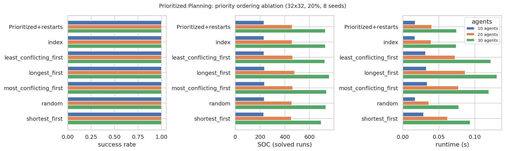

Every ordering succeeded on every instance of this suite (32×32, 20 %, 10/20/30
agents), so the ordering affects **quality**, not feasibility:

| priority order | SOC gap @10 | @20 | @30 | time @30 |
|---|---|---|---|---|
| **shortest_first** | **0.46 %** | **0.81 %** | **1.36 %** | 0.093 s |
| least_conflicting_first | 0.76 % | 3.50 % | 5.73 % | 0.122 s |
| index (as generated) | 1.51 % | 2.47 % | 6.37 % | 0.074 s |
| random | 1.86 % | 1.58 % | 7.15 % | 0.077 s |
| most_conflicting_first | 2.87 % | 3.44 % | 7.93 % | 0.119 s |
| **longest_first** | 2.95 % | 6.73 % | **11.07 %** | 0.131 s |

This is a genuinely useful — and cheap — finding: the intuitive "give priority
to the agent with the longest route" rule is the **worst** of the six, while the
opposite rule ("shortest route first") is the best and is nearly optimal (1.4 %
above SIC even at 30 agents, against 6.4 % for the default order). The
mechanism is easy to state: an agent with a short route has few alternative
routes, so making *it* yield is expensive, whereas a long-route agent usually
has slack to absorb a detour. The cost of the better rule is a few milliseconds.

### 6.8 Paired comparisons (same instances)

Because every algorithm sees every instance, comparisons can be paired, which
removes instance difficulty from the comparison. On the 50 scalability instances
that **both** planners solved:

| metric | Prioritized − CBS | CBS better in | Wilcoxon signed-rank |
|---|---|---|---|
| runtime | **−0.47 s** (PP faster) | 22 % | p = 1.9 × 10⁻⁸ |
| SOC | **+7.82** (PP costs more) | **100 %** | p = 7.8 × 10⁻⁷ |
| makespan | 0.00 | 4 % | p = 1.00 (no difference) |

So over the instances both can solve: Prioritized Planning is significantly
faster (by about half a second), CBS is significantly cheaper (never worse, as
theory requires, and usually better), and **neither is better in makespan** —
optimising sum-of-costs does not buy a shorter schedule.

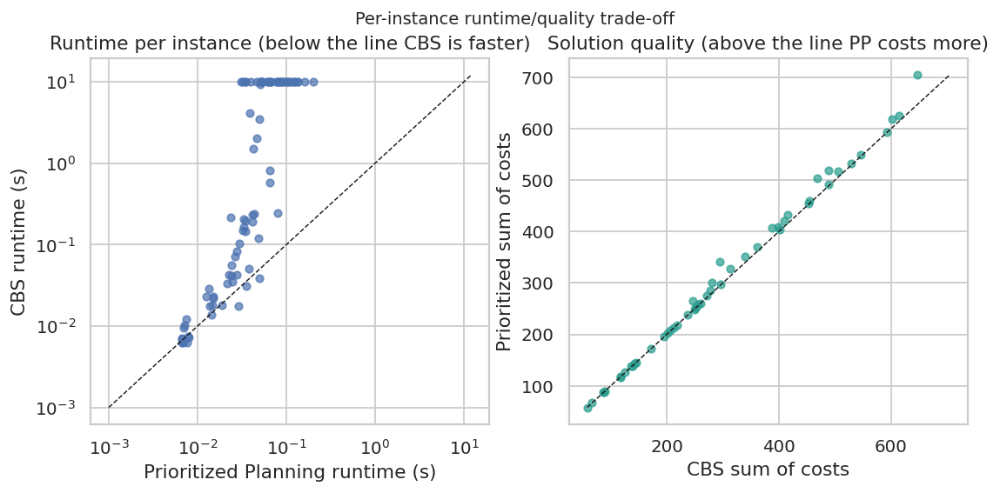

---

## 7. Analysis: answering the experimental questions

**Q1. How does increasing the number of agents affect planning difficulty?**
Steeply, and differently for each strategy. The coordination burden (conflicts
in the naive plan) grows super-linearly (Section 6.2: 0.3 → 55.9 conflicts from
5 to 40 agents). Prioritized Planning's cost grows close to linearly and stays
in the milliseconds. CBS's cost grows exponentially: success falls from 92 % at
15 agents to 8 % at 30 under a 10 s budget.

**Q2. How does obstacle density affect each algorithm?**
Weakly at low agent counts (10 agents: CBS is at 100 % up to 30 % obstacles) and
dramatically once the fleet is large relative to the free space (20 agents:
everything collapses at 30–40 % obstacles, including Prioritized Planning, which
falls from 100 % to 13 %). Density matters through *congestion*, not through
obstacle count: with 20 agents the empty map is no easier for CBS than the 20 %
map.

**Q3. When does Prioritized Planning outperform CBS in runtime?**
Essentially always on the instances they both solve (78 % of pairs, mean saving
0.47 s, p ≈ 2 × 10⁻⁸), and by up to two orders of magnitude (6× at 15 agents, 136× at 30) on the crowded
instances where CBS cannot finish at all. CBS's only runtime advantage in our
data appears at 5 agents, where both are instantaneous (9 ms vs 8 ms).

**Q4. When does Prioritized Planning fail even though a solution exists?**
In bottlenecks. Concretely: 94 % success on room maps (vs 100 % on random maps),
75 % at 30 % obstacles with 20 agents, 13 % at 40 %, and 25 % on mazes. The
mechanism is visible in the failure records — a lower-priority agent is blocked
by a *permanent* reservation (usually the goal cell of a higher-priority agent)
and the time-expanded A* returns "no path". Restarting with a different priority
order is the cheap fix: `Prioritized+restarts` matched the best single order in
our runs. Sections 6.4 and 6.7 show that this failure mode is a property of the
*topology*, not of the fleet size.

**Q5. How does CBS trade computational cost for solution quality?**
On the instances it can solve, CBS is 0.53 % above the SIC lower bound on
average (worst case 11 %) against 4.2 % for Prioritized Planning — and on the
59 hold-out instances that CBS solved, the matched comparison is 0.65 % vs
4.45 %, i.e. CBS removes about 85 % of the excess cost. The price is a runtime
distribution with an enormous tail (mean 3.86 s vs median 0.215 s) and a success
rate of 65 %. Note that CBS's quality advantage is *not* visible in makespan
(p = 1.0): it buys cheaper routes, not a faster fleet.

**Q6. Which environments create the most conflicts?**
Ranked by conflicts in the naive plan: mazes (40.3) > "far" start/goal pairs
(29.9) > rooms (20.1) > clustered goals (18.9) ≈ 40 agents on a 32×32 map
(55.9, the highest of all) > uniform 20 agents (9.6) ≈ random maps (9.6) >
clusters (7.7) > "near" goals (1.1). Two environmental properties generate
conflicts: **narrow topology** (mazes, doorways) and **long crossing paths**
(far goals).
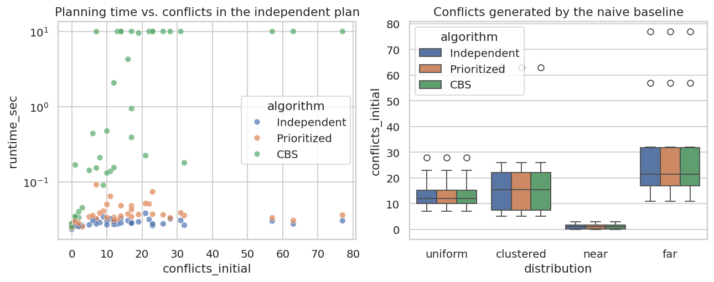

**Q7. Is there evidence that no single coordination strategy is best for every
environment?**
Yes, and it is the most actionable result. CBS is strictly better in quality
wherever it terminates, but terminates on 100 % of "near"-goal instances and
only 40 % of "far"-goal instances, on 94 % of 64×64 maps and 44 % of 16×16
maps, on 88 % of random maps and 0 % of mazes. Prioritized Planning is
essentially always feasible and fast, but gives up 1–11 % of cost — and loses
25 % of maze instances as well. The *ranking* of the two strategies flips with
measurable, cheaply computable properties of the instance, which is exactly the
precondition for the extension in Section 8.

**Summary of the trade-off.** Prioritized Planning should be the default when
feasibility and latency matter (real-time systems, large fleets, constrained
topologies); CBS should be used when plan quality is paid for per timestep
(warehouse throughput, battery life) *and* the instance is known to be tractable
(≤ ~20 agents on a 32×32 map at 20 % obstacles, moderate congestion). When in
doubt, run Prioritized Planning with the `shortest_first` ordering: it costs
milliseconds and recovers most of the quality gap.

---

## 8. Optional extension: adaptive strategy selection

*Everything in this section is an extension, not a reproduction of published
work.* The question: given an instance, can we predict whether CBS or
Prioritized Planning is the better choice, using only cheap features?

**Features** (all computable before any coordinated planning; the independent
plan costs one single-agent A* per agent): number of agents, obstacle density,
agent density (agents per free cell), mean Manhattan start–goal distance, and
the number of conflicts in the independent plan.

**Objective.** Utility is parameterised because the answer depends on how much
the application cares about optimality:

```
U(α) = solved × [ α · (1 − gap / 0.15) + (1 − α) · (1 − runtime / budget) ]
```

A failure scores 0 (an unsolved instance is a fleet that does not move).

**Method.** 108 mixed-condition instances (`adaptive_holdout` suite, disjoint
from the analysis above) are labelled with the *oracle* choice under U(0.5). Two
lightweight selectors are trained to imitate the oracle and evaluated with
5-fold cross-validation, so a selector never sees the instance it is scored on:

* a **threshold rule** fitted by exhaustive search (example fold: *"use CBS iff
  conflicts ≤ 11 and agent density ≤ 0.024"*);
* a **logistic regression** in NumPy (fitted weights: agent density −0.80,
  initial conflicts −0.80, obstacle density −0.42, agents −0.10).

**Results** (means over 105 instances; `α` = weight on solution quality):

| strategy | success | mean runtime | SOC gap (solved) | U(0.25) | U(0.50) | U(0.75) |
|---|---|---|---|---|---|---|
| Always Prioritized | **100 %** | **0.047 s** | 6.29 % | **0.900** | 0.805 | 0.710 |
| Always CBS | 56 % | 4.69 s | **0.65 %** | 0.532 | 0.534 | 0.536 |
| Adaptive (threshold rule) | 97 % | 0.43 s | 4.80 % | 0.888 | **0.818** | **0.749** |
| Adaptive (logistic) | 97 % | 0.40 s | 4.97 % | 0.887 | 0.815 | 0.742 |
| Oracle (unattainable) | 100 % | 0.18 s | 4.21 % | 0.921 | 0.860 | 0.799 |

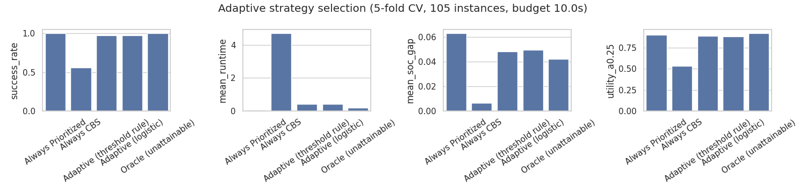

**What this shows.**

1. The instance features *are* informative: the oracle prefers CBS on 43 % of
   instances; under 5-fold cross-validation the threshold rule agrees with it on
   **74 %** of held-out instances and the logistic model on **77 %**, against
   57 % for the trivial "always Prioritized" rule.
2. The most predictive features are **agent density** (r = −0.54 with the
   oracle's preference), **number of agents** (−0.48) and **initial conflicts**
   (−0.45): CBS is preferred when the fleet is small relative to the free space
   and the naive plan is nearly feasible. Obstacle density alone is a weak
   predictor (−0.24), which is consistent with Section 6.3.
3. Whether the selector *pays off* depends on the weighting. It beats
   always-Prioritized whenever quality carries at least as much weight as speed
   (U(0.5): 0.818 vs 0.805; U(0.75): 0.749 vs 0.710 — it recovers 24–44 % of the
   distance between always-PP and the oracle), and loses slightly when speed
   dominates (U(0.25): 0.888 vs 0.900), because it spends ~0.4 s on instances
   where the plan was never going to improve much.
4. **Honest caveat.** In this operating regime Prioritized Planning is a very
   strong baseline: it succeeds everywhere and is only 6 % above the lower
   bound. A selector can only redistribute a small surplus, so the absolute
   gains are modest. The extension is a proof of mechanism, not a performance
   breakthrough — and it would look much better with a larger time budget, where
   CBS succeeds on more instances and the quality term has more room to matter.

---

## 9. Threats to validity and limitations

* **Success-conditioned quality.** SOC gaps are averages over *solved* runs. CBS
  only solves the easier instances, so its quality numbers are optimistic and
  Prioritized Planning's are not directly comparable. We mitigate this by always
  reporting the success rate next to the quality figure and by adding the
  matched-subset comparison in Section 8 (0.65 % vs 4.45 % on the same 59
  instances) — but the bias cannot be removed entirely.
* **Time budget.** 10 s per run is arbitrary. It shapes every success rate:
  with 60 s the CBS curves would shift right, not change shape. All conclusions
  are stated relative to this budget.
* **Unsolvability is not decidable here.** On an unsolvable instance the CBS
  constraint tree is infinite (every repaired plan meets a new conflict later in
  time), so CBS cannot report "unsolvable" — such runs are recorded as timeouts.
  Prioritized Planning, by contrast, reports `no_solution`, which is a property
  of the *order*, not a proof about the instance.
* **Absolute runtimes are implementation-bound.** This is plain Python;
  optimised C++ CBS implementations are one to two orders of magnitude faster.
  The *relative* comparisons and the *shapes* of the curves are the transferable
  results, not the exact agent counts at which CBS time out.
* **Procedural benchmarks only.** No MovingAI benchmark maps are bundled (they
  are large and separately licensed). `environment/benchmarks.py` reads and
  writes the standard `.map`/`.scen` format, and an example instance is exported
  to `data/benchmarks/`; pointing the pipeline at the real benchmark set is a
  drop-in change.
* **Single-objective optimality.** CBS optimises SOC. Makespan-optimal and
  bounded-suboptimal variants would likely change the quality conclusions
  (Section 6.8 already shows SOC optimality buys nothing in makespan).
* **Map generator.** Uniform and structured random maps do not capture every
  real warehouse layout; the maze structure in particular is an extreme case
  included to probe the limits, not to model an application.
* **The extension is small.** 108 hold-out instances, five features, two model
  classes, no hyper-parameter search beyond the built-in grid, and no comparison
  against a modern portfolio algorithm-selection method.

---

## 10. Conclusion

We reproduced three classical MAPF coordination strategies, validated them
(113 tests, including an exhaustive optimality cross-check of CBS), and measured
them under a controlled design that varied five environmental factors with
several seeds per condition.

The consistent picture is a **feasibility/optimality trade-off whose balance
depends on congestion**. Independent A* is free and useless beyond a handful of
agents. Prioritized Planning is fast, nearly always feasible, and 1–11 % above
the theoretical lower bound — less if the agents are planned shortest-route
first, which our ablation shows is the best of six orderings. CBS is optimal but
heavy-tailed: unbeatable in quality where it terminates, unusable on mazes,
crowded small maps, and fleets beyond ~25 agents under a 10 s budget. No single
strategy dominates, and the cheap features that predict which one will win
(agent density, fleet size, conflicts in the naive plan) can be used to choose
automatically — the extension in Section 8 recovers 24–44 % of the gap between
always-Prioritized and an oracle, at the cost of 0.4 s per instance.

**Most useful practical takeaways.** (i) Run Prioritized Planning with the
`shortest_first` ordering as the default — it is milliseconds and near-optimal.
(ii) Reach for CBS only when the instance is small relative to its free space or
when plan quality is directly monetised. (iii) Measure the conflicts in the
independent plan first: it is a one-line, planner-agnostic difficulty index that
predicted CBS's success rate better than obstacle density did.

**Future work.** Bounded-suboptimal CBS (which trades the last few percent of
cost for large speed-ups) would move the interesting crossover point; windowed
or lifelong MAPF would make the study closer to real warehouse operation; and a
larger, benchmark-based instance pool with a proper algorithm-portfolio
evaluation would put the adaptive extension on firmer statistical ground.

---

## 11. Reproducing this report

```bash
python -m pytest tests -q                  # 113 tests
python scripts/run_experiments.py --workers 2      # ~20 min on 2 cores
python scripts/make_plots.py               # all figures -> results/figures
python scripts/analyze.py --json           # all tables -> results/tables
python scripts/run_adaptive.py             # Section 8
python scripts/make_example_figure.py      # the three-panel example figure
python -m app.server --port 8000           # interactive demo
```

Raw per-run data: `results/raw/<suite>.jsonl` (+ `.csv` view). Configuration:
`config/suites.json`. Environment and suite manifest:
`results/raw/manifest.json`. The first (superseded) experimental run, produced
before the map-generator fix described in Section 5, is archived in
`results/raw_superseded_v1/` for transparency.

### Interactive demo

`python -m app.server` serves a single-page application (no build step, no CDN)
that lets you generate or hand-edit a map, choose a planner, watch the resulting
plan animate, and compare all strategies on the same instance side by side. It
shows planning time, SOC, makespan, the SIC lower bound, the SOC gap, the
conflicts produced by the naive plan (flashed in red at the timestep where each
collision occurs) and CBS's high-level expansions — i.e. the quantities this
report argues about, on instances you choose.

---

## References

* Hart, P., Nilsson, N. & Raphael, B. (1968). *A Formal Basis for the Heuristic
  Determination of Minimum Cost Paths.* IEEE Trans. SSC 4(2).
* Kornhauser, D., Miller, G. & Spirakis, P. (1984). *Coordinating Pebble Motion
  on Graphs, the Diameter of Permutation Groups, and Applications.* FOCS.
* Erdmann, M. & Lozano-Pérez, T. (1987). *On Multiple Moving Objects.* ICRA.
* Silver, D. (2005). *Cooperative Pathfinding.* AIIDE.
* Standley, T. (2010). *Finding Optimal Solutions to Cooperative Pathfinding
  Problems.* AAAI.
* Wagner, G. & Choset, H. (2011). *MAPP: a Scalable Multi-Agent Path Planning
  Algorithm with Tractability and Completeness Guarantees.* AAAI.
* Sharon, G., Stern, R., Felner, A. & Sturtevant, N. (2015). *Conflict-Based
  Search for Optimal Multi-Agent Pathfinding.* Artificial Intelligence 219,
  40–66.
* Stern, R., Sturtevant, N., Felner, A., Koenig, S., Ma, H., Walker, T., Li, J.,
  Atzmon, D., Cohen, L., Kumar, T., Boyarski, E. & Barták, R. (2019).
  *Multi-Agent Pathfinding: Definitions, Variants, and Benchmarks.* SoCS.
