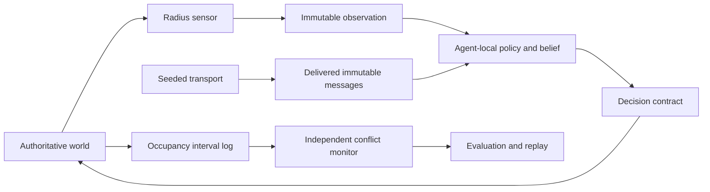

# Additive architecture and validation sequence

The event clock owns order and actual action completion. Sensors copy only
permitted facts. A policy has no world, GridMap, Scenario, simulator callback,
global BFS or shared global reservation table argument. This is an architectural
boundary, not a security sandbox against malicious Python introspection.

1. Validate queue ties/zero-latency causality and analytic interval conflicts.
2. Validate world completion identity, hidden-cell counterfactuals and sensing.
3. Validate packet loss/range/duplicate/reorder/byte accounting and belief age.
4. Exercise fixed scripted trajectories in the same engine; save replay traces
   and compare raw interval-derived metrics. These are validation fixtures, not
   MAPF baselines or evidence for a research improvement.
5. Add authenticated published baseline adapters only after full-text and code
   audits. Then implement/test a candidate protocol if G1 survives.

Legacy files are retained. The only planned legacy correction is the audited
first-goal-entry constraint in space-time A*, with original and repaired evidence
in separate directories. Existing UI edits and original result archives remain
outside research commits.
